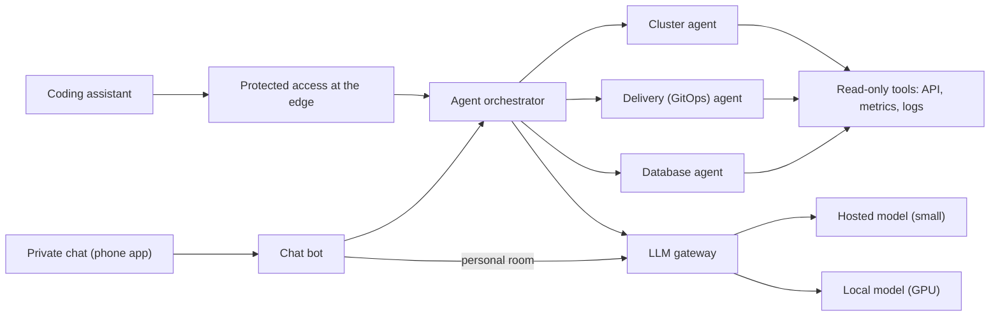

# Agents and chat

A set of **read-only agents** answers questions about the cluster (state of pods, delivery and databases). The same intelligence serves more than one channel: a **private chat** on the phone and the **coding assistant** on the computer.

## Principles

- **Read-only.** No agent has a tool that changes the cluster. If something must change, the agent describes the change and it goes in as a pull request like any other.
- **One intelligence, several channels.** The chat and the assistant are thin adapters. Swapping or adding a channel doesn't touch the agents.
- **The right model for each task.** Deterministic code first; then the local model; then a small hosted model; and only last the main assistant. Each layer receives only the summary from the one below, so raw logs never enter the expensive context.
- **Personal data stays on the local model.** The personal room uses a model that only runs at home, with no paid fallback if it fails.

## Two entry points

- **Private chat:** an open, self-hosted chat server with registration closed and no federation, and an ordinary phone app. The bot answers only people on an allowlist and only when addressed (a mention, a reply to one of its messages, or a command). It also posts cluster notices into the rooms.
- **Coding assistant:** the orchestrator is exposed at a protected address. To the assistant it looks like two tools: list agents and invoke an agent.

## Protecting remote access

A controller with no authentication of its own is never exposed alone. Three layers:

1. **Identity at the edge:** SSO login for people and one service token per client, each revocable on its own.
2. **Validation at the origin:** the tunnel connector checks the token's signature and audience, so a mistake in an edge policy doesn't open the service.
3. **No open port:** services are internal to the cluster; the tunnel is the only way in.

## Observability

A request produces a single trace, from the bot through the agent to the model call and the tool. The bot's events are structured and **never** carry message text. A dashboard shows volume, latency, failures and answer ratings (people's reactions), and a fixed set of questions works as a regression test when changing a model or a prompt.

## Trade-offs

- (+) Operational questions answered without bringing logs into the main assistant's context.
- (+) Predictable cost: the hosted model only enters where tool calling must be reliable.
- (−) A small local model fails at tool calling and at following language rules; so agents with tools use the hosted one, and the local one is kept for summaries, classification and personal data.
- (−) A room with a bot isn't end-to-end encrypted, because the bot must read the messages. Acceptable when everything runs on your own infrastructure.
- (−) More pieces to maintain: chat server, bot, orchestrator and the access layer.
