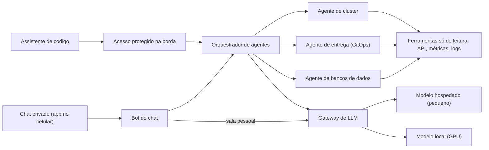

# Agentes e chat

Um conjunto de **agentes de leitura** responde a perguntas sobre o cluster (estado dos pods, da entrega e dos bancos). A mesma inteligência atende por mais de um canal: um **chat privado** no celular e o **assistente de código** no computador.

## Princípios

- **Só leitura.** Nenhum agente tem ferramenta que altere o cluster. Se algo precisa mudar, o agente descreve a mudança e ela entra por pull request, como qualquer outra.
- **Uma inteligência, vários canais.** O chat e o assistente são adaptadores finos. Trocar ou acrescentar um canal não mexe nos agentes.
- **O modelo certo para cada tarefa.** Código determinístico primeiro; depois o modelo local; depois um modelo hospedado pequeno; e só no fim o assistente principal. Cada camada recebe apenas o resumo da de baixo, então o log bruto nunca entra no contexto caro.
- **Dado pessoal fica no modelo local.** A sala pessoal usa um modelo que só roda em casa, sem alternativa paga caso ele falhe.

## Duas portas de entrada

- **Chat privado:** um servidor de chat aberto e auto-hospedado, com cadastro fechado e sem federação, e um app comum no celular. O bot só responde a quem está numa lista e só quando é chamado (menção, resposta a uma mensagem dele ou comando). Também publica avisos do cluster nas salas.
- **Assistente de código:** o orquestrador é exposto por um endereço protegido. Para o assistente, ele aparece como duas ferramentas: listar agentes e invocar um agente.

## Proteção do acesso remoto

Um controlador sem autenticação própria nunca é exposto sozinho. São três camadas:

1. **Identidade na borda:** login por SSO para pessoas e um token de serviço por cliente, cada um revogável sozinho.
2. **Validação na origem:** o conector do túnel confere a assinatura e o público do token, então um erro numa política da borda não abre o serviço.
3. **Sem porta aberta:** os serviços são internos ao cluster; o túnel é o único caminho de fora.

## Observabilidade

Um pedido gera um trace único, do bot ao agente, à chamada de modelo e à ferramenta. Os eventos do bot são estruturados e **nunca** carregam o texto das mensagens. Um painel mostra volume, latência, falhas e a avaliação das respostas (reações das pessoas), e um conjunto fixo de perguntas serve de teste de regressão ao trocar modelo ou prompt.

## Uma pergunta, passo a passo

1. Alguém escreve no chat privado: "como está o cluster?"
2. O bot confirma que quem escreveu está na lista de permitidos e que foi chamado, e entrega a pergunta ao orquestrador.
3. O orquestrador escolhe o agente de cluster, que lê pods, eventos, métricas e logs por ferramentas só de leitura.
4. O agente pede ao modelo hospedado que raciocine sobre essa evidência e devolve uma resposta curta no idioma de quem perguntou.
5. O bot responde na sala; um polegar para cima ou para baixo fica guardado como feedback de qualidade.

O mesmo fluxo corre agendado: todas as manhãs um workflow pede um resumo de saúde e publica na sala da família.

## Porquê assim

O objetivo nunca foi "um chatbot". Foi parar de colar paredes de logs num contexto caro, ter respostas onde as pessoas já estão (o telemóvel) e manter documentos pessoais em hardware em casa. Tudo o resto decorre destes três limites.

## Trade-offs

- (+) Perguntas operacionais respondidas sem levar logs para o contexto do assistente principal.
- (+) Custo previsível: o modelo hospedado só entra onde precisa chamar ferramentas com confiabilidade.
- (−) Um modelo local pequeno falha em chamar ferramentas e em seguir regras de idioma; por isso os agentes com ferramentas usam o hospedado e o local fica para resumos, classificação e dados pessoais.
- (−) A sala com bot não é criptografada ponta a ponta, porque o bot precisa ler as mensagens. Aceitável quando tudo roda em infraestrutura própria.
- (−) Mais peças para manter: servidor de chat, bot, orquestrador e a camada de acesso.
