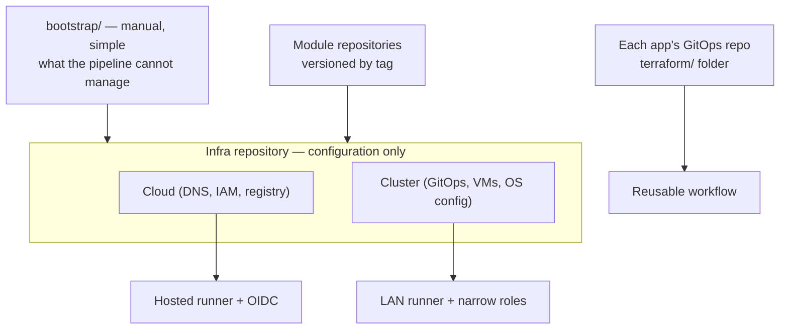

# Two-tier IaC

Infrastructure as code is split into two tiers with **disjoint boundaries**, and the foundation lives in a **single
repository**.

| Tier | Scope | How it runs |
|---|---|---|
| **Foundation** | Identity, registry, DNS, network, VMs and the cluster layers | One repository, Terragrunt; each provider on the executor that suits it |
| **Per application** | Resources owned by one application (a database, a bucket) | In the `terraform/` folder of the app's GitOps repository, by a reusable workflow |

## What was decided

- **One repository.** There used to be two (cloud and cluster), with two execution models and two ways to review a
  change. Now it is one place, one flow.
- **The manual step is a folder, not a repository.** `bootstrap/` holds only what the pipeline cannot manage itself
  (the roles it assumes), the initial secrets and the installation of the LAN executor. It is simple on purpose (bash
  or a small tofu) and never runs in CI.
- **Modules live outside the repository, one repository each, tagged.** The infra units hold configuration only.
  Bumping a version is a one-line PR, and the pipeline plans just that unit.
- **Each provider on its own executor.** The cloud runs on hosted runners with federated identity. The cluster runs
  on a runner inside the home network, with narrow roles and secrets in a managed vault, never stored on the executor.
- **Only what changed runs.** The pipeline finds the affected units from the changed file.
- **Blast radius decides the gate, not the repository.** What is safe applies after the merge; what touches nodes or
  VMs needs an extra human step, with the plan visible first.

## The rule that prevents disasters

The two tiers **never** point at the same layer or state. If they did, each would try to reconcile what the other
created. The same holds inside the foundation: every layer has its own state key, and adopting an existing resource
requires a first plan with **no differences**; if there are any, fix the code, not reality.

## Trade-offs

- (+) One review flow; upgrading a critical piece is a one-line PR with a plan for that piece only.
- (+) Versioned modules, testable in isolation, with no environment values inside them.
- (+) An application owner can request infrastructure without touching the foundation.
- (−) The LAN runner is a point of failure for *changing* the infra (not for traffic).
- (−) Two executors (hosted and LAN) to keep aligned.
- (−) Some plans do not show up on the PR, because the credentials they would need are admin-equivalent (see
  [Lessons learned](../lessons.md)).
