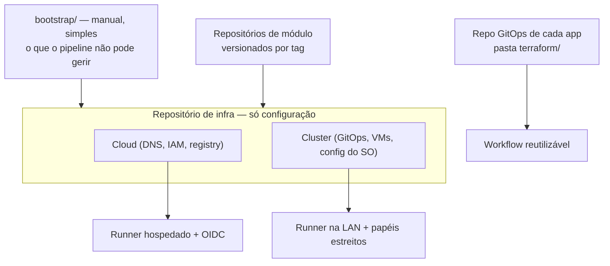

# IaC em dois níveis

Infraestrutura como código é dividida em dois níveis com **fronteiras disjuntas**, e a fundação vive num **único
repositório**.

| Nível | Escopo | Como roda |
|---|---|---|
| **Fundação** | Identidade, registry, DNS, rede, VMs e as camadas do cluster | Um repositório, Terragrunt; cada provider no executor que lhe convém |
| **Por aplicação** | Recursos que pertencem a uma aplicação (um banco, um bucket) | Na pasta `terraform/` do repositório GitOps da app, por um workflow reutilizável |

## O que ficou decidido

- **Um repositório só.** Antes eram dois (cloud e cluster), com dois modelos de execução e duas formas de rever
  mudanças. Agora é um sítio, um fluxo.
- **O passo manual é uma pasta, não um repositório.** `bootstrap/` guarda só o que o próprio pipeline não pode gerir
  (os papéis que ele assume), os segredos iniciais e a instalação do executor da LAN. É simples de propósito (bash ou
  um tofu pequeno) e nunca corre em CI.
- **Módulos fora do repositório, um por repositório, com tag.** As unidades de infra só têm configuração. Subir uma
  versão é um PR de uma linha, e o pipeline planeia só essa unidade.
- **Cada provider no seu executor.** A cloud corre em runners hospedados com identidade federada. O cluster corre num
  runner dentro da rede de casa, com papéis estreitos e segredos num cofre gerido, nunca guardados no executor.
- **Só o que mudou corre.** O pipeline descobre as unidades afetadas pelo ficheiro alterado.
- **O raio de impacto decide o portão, não o repositório.** O que é seguro aplica-se após o merge; o que mexe em nós ou
  VMs exige um passo humano extra, com o plano visível antes.

## Regra que evita desastres

Os dois níveis **nunca** apontam para o mesmo layer ou state. Se apontassem, cada um tentaria reconciliar o que o
outro criou. O mesmo vale dentro da fundação: cada camada tem a sua chave de state, e adotar recurso existente exige
um primeiro plano **sem diferenças**; se houver, corrige-se o código, não a realidade.

## Trade-offs

- (+) Um só fluxo de revisão; atualizar uma peça crítica é um PR de uma linha com plano só dessa peça.
- (+) Módulos versionados e testáveis isoladamente, sem valores do ambiente dentro deles.
- (+) Quem é dono da aplicação pede infraestrutura sem tocar a fundação.
- (−) O runner da LAN é um ponto de falha para *mudar* a infra (não para o tráfego).
- (−) Dois executores (hospedado e LAN) para manter alinhados.
- (−) Alguns planos não aparecem no PR, porque as credenciais que exigiriam equivalem a admin (ver
  [Lições aprendidas](../lessons.md)).
